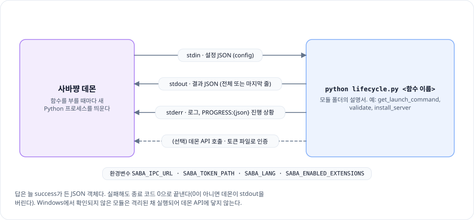

# saba-chan-modules

[사바쨩](https://github.com/WareAoba/saba-chan)이 게임 서버를 다룰 때 읽는 게임별 설명서, "모듈"을 모아 둔 저장소예요. 모듈 하나가 게임 하나이고, 설치 방법, 실행 명령, 설정 항목, 서버가 다 켜졌는지 알아보는 법 같은 게임마다 다른 부분이 여기에 들어 있어요.

| 모듈 | 게임 | 설치 |
|---|---|---|
| [minecraft](minecraft/) | Minecraft (Java) | 공식 서버 파일 |
| [palworld](palworld/) | Palworld | SteamCMD |
| [zomboid](zomboid/) | Project Zomboid | SteamCMD |
| [terraria](terraria/) | Terraria | 공식 서버 파일 |

## 생김새

```
<게임>/
  module.toml    무엇을 할 수 있는지 (설정 항목, 명령, 지원 OS·CPU, 설치 방법)
  lifecycle.py   어떻게 하는지 (설치, 시작, 상태 확인 같은 함수)
  locales/       화면에 보일 문구 (10개 언어)
```

데몬은 필요할 때마다 `python lifecycle.py <함수 이름>`을 한 번씩 실행해요. 입력은 stdin JSON으로 주고, 결과는 stdout JSON으로 받아요.

<p align="center">
  <picture>
    <source media="(prefers-color-scheme: dark)" srcset="docs/images/module-call-dark.svg">
    
  </picture>
</p>

## 모듈 만들기

1. `__example/`을 복사해서 시작하거나, `python maker/new_module.py <이름> --game-name "<게임 이름>"`으로 뼈대를 만들어요.
2. [모듈 만들기 안내](docs/module-development-guide.md)와 [모듈 계약](docs/module-spec.md)을 보면서 채워요. 계약이 헷갈리면 사바쨩 저장소의 [02-modules.md](https://github.com/WareAoba/saba-chan/blob/main/docs/architecture/02-modules.md)가 코드와 맞춰 둔 쪽이에요.
3. `pip install -r requirements-dev.txt` 뒤 `pytest`(모듈 테스트)와 `pytest conformance`(적합성 검사)를 돌려요.

Claude Code나 Codex 같은 AI 에이전트에게 맡길 거라면 [모듈 메이커](maker/README.md)를 쓰세요. 조사부터 실제 서버 실행 확인까지 같은 절차를 따르게 해 줘요.

---

## English

Per-game "modules" for [Saba-chan](https://github.com/WareAoba/saba-chan). Each module is one game: `module.toml` says what it can do, `lifecycle.py` says how, and `locales/` holds the UI text. The daemon runs `python lifecycle.py <function>` once per call, with JSON on stdin and JSON back on stdout. To write one, copy `__example/` (or run `maker/new_module.py`), follow the [development guide](docs/module-development-guide.md) (Korean), and run `pytest` plus `pytest conformance`. For AI agents there's the [module maker](maker/README.md).

## 日本語

[サバちゃん](https://github.com/WareAoba/saba-chan)のゲームごとの「モジュール」です。1 モジュールが 1 ゲームで、`module.toml` に何ができるか、`lifecycle.py` にどうやるか、`locales/` に画面の文言が入っています。デーモンは呼ぶたびに `python lifecycle.py <関数名>` を 1 回実行し、stdin の JSON で入力を渡して stdout の JSON で結果を受け取ります。作るときは `__example/` をコピーするか `maker/new_module.py` を使い、[作り方ガイド](docs/module-development-guide.md)(韓国語)を見ながら書いて `pytest` と `pytest conformance` で確かめてください。AI エージェントに任せるなら[モジュールメーカー](maker/README.md)があります。
