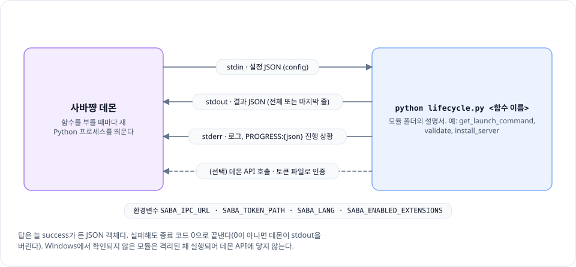

<div align="center">

<picture>
  <source media="(prefers-color-scheme: dark)" srcset="docs/images/banner-ko-dark.png">
  
</picture>

### saba-chan-modules

사바쨩이 게임 서버를 다루는 게임별 설명서, 모듈

[웹사이트](https://saba-chan.online/ko) · [사용 안내](https://saba-chan.online/ko/guide) · [사바쨩](https://github.com/WareAoba/saba-chan) · [익스텐션](https://github.com/WareAoba/saba-chan-extensions)

[](LICENSE)

</div>

[사바쨩](https://saba-chan.online)이 게임 서버를 다룰 때 읽는 게임별 설명서, "모듈"을 모아 둔 저장소예요. 모듈 하나가 게임 하나이고, 설치 방법, 실행 명령, 설정 항목, 서버가 다 켜졌는지 알아보는 법 같은 게임마다 다른 부분이 여기에 들어 있어요. 사바쨩 본체는 [WareAoba/saba-chan](https://github.com/WareAoba/saba-chan)에 있어요.

## 지원하는 게임

| 모듈 | 게임 | 버전 | 서버 설치 | 같이 쓰는 익스텐션 | CPU |
|---|---|---|---|---|---|
| [minecraft](minecraft/) | Minecraft (Java) | 0.1.11 | 서버 파일 내려받기 (Vanilla, Paper, Fabric, Forge 등 11종) | 없음 | x86_64, ARM64 |
| [palworld](palworld/) | Palworld | 0.1.11 | SteamCMD | steamcmd 0.1.5 이상, ue4-ini 0.1.7 이상 | x86_64 |
| [zomboid](zomboid/) | Project Zomboid | 0.1.10 | SteamCMD | steamcmd 0.1.5 이상 | x86_64 |
| [terraria](terraria/) | Terraria | 0.1.4 | 서버 파일 내려받기 | xna 0.1.0 이상 (Windows 서버만) | x86_64 |

모든 모듈은 사바 코어(데몬) 0.1.11 이상이 필요해요. 버전은 각 모듈의 `module.toml` `[module].version`이 기준이고, 같이 쓰는 익스텐션은 [saba-chan-extensions](https://github.com/WareAoba/saba-chan-extensions)에 있어요.

## 설치하고 쓰기

- **앱**: 사바 스토리지의 모듈 탭에서 원하는 게임을 설치해요. 서버 추가 창에서 게임을 고를 때도 설치할 수 있어요.
- **CLI**: `saba-chan-cli module available`로 받을 수 있는 모듈을 보고, `saba-chan-cli module install <모듈>`로 설치해요.
- 모듈을 설치하면 그 모듈이 쓰는 익스텐션도 같이 받고 켜져요. 앱을 업데이트하면서 모듈이 새 익스텐션을 필요로 하게 돼도 마찬가지예요.

서버를 추가하고 돌리는 방법은 [서버 추가 안내](https://saba-chan.online/guide/add-server)에, 모듈 구조는 [모듈 문서](https://saba-chan.online/docs/modules)에 있어요.

## 생김새

```
<게임>/
  module.toml    무엇을 할 수 있는지 (설정 항목, 명령, 지원 OS·CPU, 설치 방법)
  lifecycle.py   어떻게 하는지 (설치, 시작, 상태 확인 같은 함수)
  locales/       화면에 보일 문구 (10개 언어)
```

데몬은 필요할 때마다 `python lifecycle.py <함수 이름>`을 한 번씩 실행해요. 입력은 stdin JSON으로 주고, 결과는 stdout JSON으로 받아요.

<p align="center">
  <picture>
    <source media="(prefers-color-scheme: dark)" srcset="docs/images/module-call-dark.svg">
    
  </picture>
</p>

## 모듈 만들기

1. `__example/`을 복사해서 시작하거나, `python maker/new_module.py <이름> --game-name "<게임 이름>"`으로 뼈대를 만들어요.
2. [모듈 만들기 안내](docs/module-development-guide.md)와 [모듈 계약](docs/module-spec.md)을 보면서 채워요. 계약이 헷갈리면 사바쨩 저장소의 [02-modules.md](https://github.com/WareAoba/saba-chan/blob/main/docs/architecture/02-modules.md)가 코드와 맞춰 둔 쪽이에요.
3. `pip install -r requirements-dev.txt` 뒤 `pytest`(모듈 테스트)와 `pytest conformance`(적합성 검사)를 돌려요.

Claude Code나 Codex 같은 AI 에이전트에게 맡길 거라면 [모듈 메이커](maker/README.md)를 쓰세요. 조사부터 실제 서버 실행 확인까지 같은 절차를 따르게 해 줘요. 사용법은 [모듈 메이커 안내](https://saba-chan.online/guide/module-maker)에도 있어요.

## 검사와 발행

- PR을 열면 `Check modules` 액션이 데몬·익스텐션과의 계약(`pytest conformance`)을 확인해요. Actions 탭에서 직접 돌리면 모듈 단위 테스트까지 해요.
- 모듈을 고쳐서 내보낼 때는 그 모듈의 `[module].version`을 올리고 `main`에 병합해요.
- 이 저장소에는 따로 발행하는 액션이 없어요. 사바쨩 앱을 발행할 때 사바쨩 저장소의 발행 액션이 이 저장소의 `main`을 받아 모듈마다 `module-<이름>.zip`을 만들고, 앱과 같은 릴리스 목록에 서명해서 올려요. 앱은 그 목록을 보고 사바 스토리지에 새 버전을 보여 줘요.

---

## English

Per-game "modules" for [Saba-chan](https://saba-chan.online). Supported games: Minecraft (Java) 0.1.11, Palworld 0.1.11, Project Zomboid 0.1.10 and Terraria 0.1.4; all need saba-core 0.1.11 or later. Install them from the Modules tab of Saba Storage in the app, or with `saba-chan-cli module install <module>`; the extensions a module needs are installed and turned on with it. Each module is one game: `module.toml` says what it can do, `lifecycle.py` says how, and `locales/` holds the UI text. The daemon runs `python lifecycle.py <function>` once per call, with JSON on stdin and JSON back on stdout. To write one, copy `__example/` (or run `maker/new_module.py`), follow the [development guide](docs/module-development-guide.md) (Korean), and run `pytest` plus `pytest conformance`. For AI agents there's the [module maker](maker/README.md). Modules ship with each Saba-chan app release: bump `[module].version`, merge to `main`, and the app's release workflow packs and signs them.

## 日本語

[サバちゃん](https://saba-chan.online)のゲームごとの「モジュール」です。対応ゲームは Minecraft (Java) 0.1.11、Palworld 0.1.11、Project Zomboid 0.1.10、Terraria 0.1.4 で、どれも saba-core 0.1.11 以上が必要です。アプリのサバ ストレージのモジュールタブか、`saba-chan-cli module install <モジュール>` でインストールします。モジュールが使う拡張機能も一緒に入ってオンになります。1 モジュールが 1 ゲームで、`module.toml` に何ができるか、`lifecycle.py` にどうやるか、`locales/` に画面の文言が入っています。デーモンは呼ぶたびに `python lifecycle.py <関数名>` を 1 回実行し、stdin の JSON で入力を渡して stdout の JSON で結果を受け取ります。作るときは `__example/` をコピーするか `maker/new_module.py` を使い、[作り方ガイド](docs/module-development-guide.md)(韓国語)を見ながら書いて `pytest` と `pytest conformance` で確かめてください。AI エージェントに任せるなら[モジュールメーカー](maker/README.md)があります。モジュールはサバちゃんアプリのリリースと一緒に配布されます。`[module].version` を上げて `main` にマージすると、アプリのリリースワークフローがまとめて署名します。
